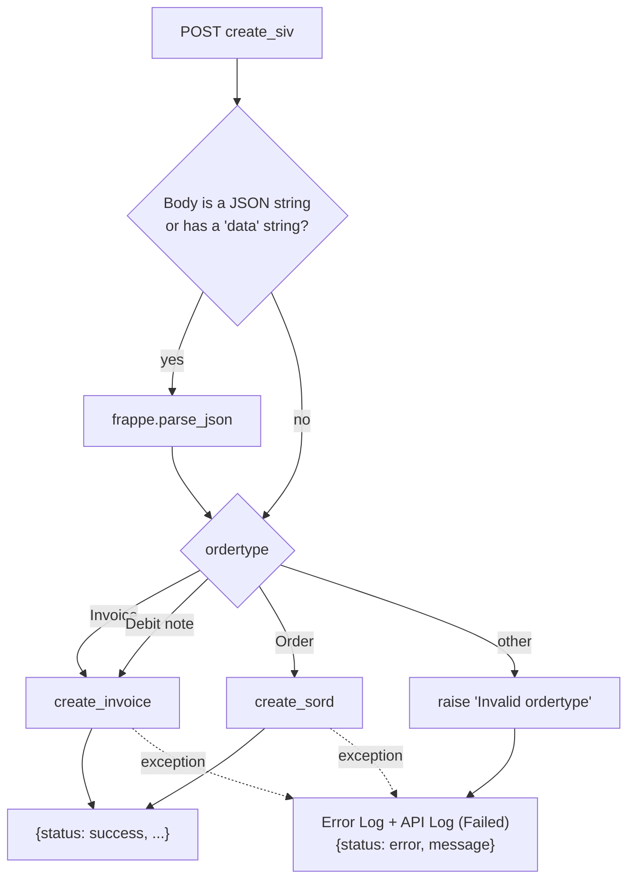
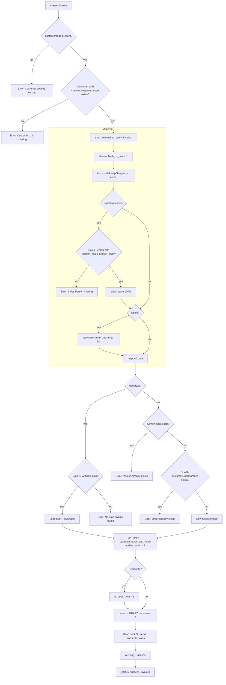
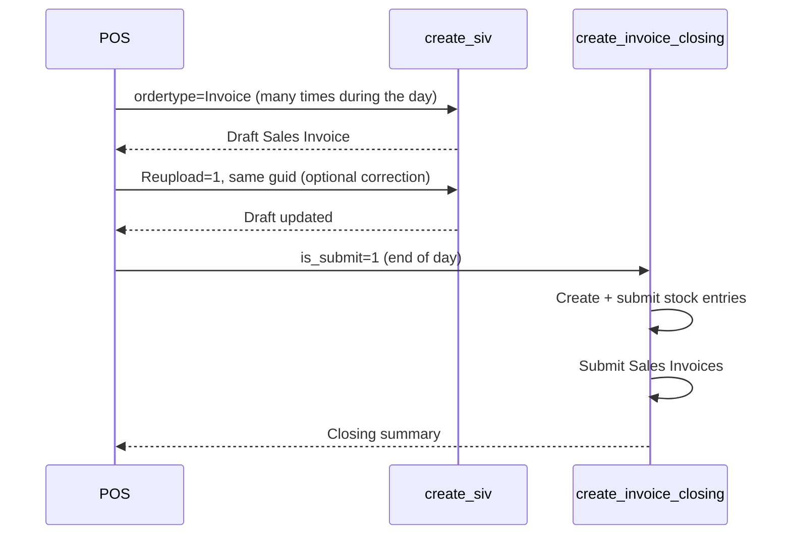
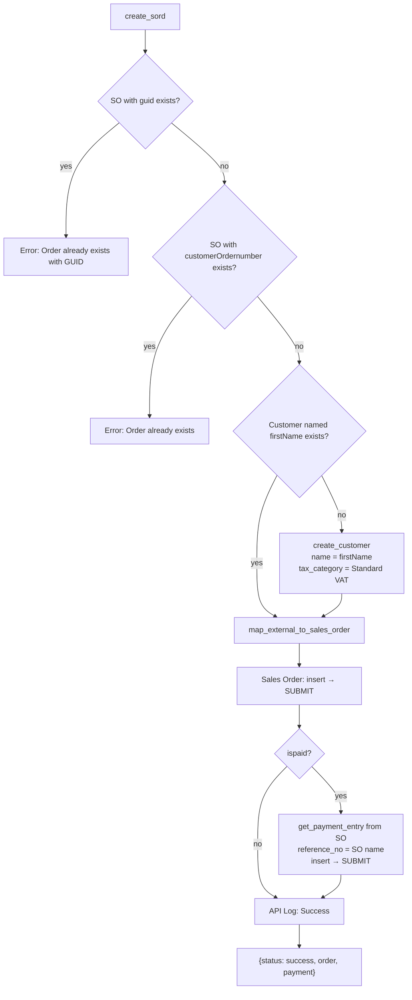

# Sales Sync API: Flow Documentation

Source: [`stringerp/v1/api.py`](../stringerp/v1/api.py)

This API takes orders and invoices from an external POS system and creates the matching ERPNext documents. A single endpoint receives every request and routes it by `ordertype`.

```
POST /api/method/stringerp.v1.api.create_siv
```

Authentication is required (`allow_guest=False`). Use token auth: `Authorization: token <api_key>:<api_secret>`.

---

## 1. Routing: `create_siv`



| `ordertype` | Handler | Result |
|---|---|---|
| `Invoice` | `create_invoice` | Draft Sales Invoice |
| `Debit note` | `create_invoice` | Draft Sales Invoice with `is_debit_note = 1` |
| `Order` | `create_sord` | Submitted Sales Order, plus a Payment Entry when paid |

> Errors come back with **HTTP 200** and `{"status": "error", "message": "..."}`. Clients must check `status` and not rely on the HTTP code.

---

## 2. Sales Invoice flow: `create_invoice`



### Lifecycle

The invoice is saved as a **draft only**. It is submitted later by `create_invoice_closing` with `is_submit = 1`. Invoice Closing `on_submit` creates and submits the stock entries, then submits the Sales Invoices.



### Field mapping (Sales Invoice)

| Payload field | Sales Invoice field |
|---|---|
| `customercode` | `customer` (looked up by `custom_customer_code`) |
| `custname` | `custom_walkin_customer_name` |
| `CRTime` (`YYYY-MM-DD HH:MM:SS`) | `posting_date` (first 10 chars) / `posting_time` (from char 12) |
| `billDate` | `due_date` |
| `Remarks` | `remarks`, `custom_order_remarks` |
| `customerOrdernumber` | `custom_customer_order_no` |
| `guid` | `custom_guid` |
| `ispaid` | `is_paid` |
| `discountAmount` | `discount_amount` (applied on Net Total) |
| `additionalDiscountGL` | `additional_discount_account` |
| `phoneNumber` / `altPhone` / `address1` | `custom_walkin_customer_phone` / `_alt_phone` / `_address` |
| `deliverymancode` | `custom_delivery_man` |
| `posProfile` | `pos_profile` |
| `salestype` | `custom_bill_type` (via `bill_type_map`) |
| `noOfPax` / `tableno` | `custom_no_of_pax` / `custom_table_no` |
| `onlineOrderId` | `custom_online_order_id` |
| `salesmancode` | `sales_team[0].sales_person` (looked up by `custom_sales_person_code`) |

Each entry in **`items[]` and `deliveryCharges[]`** becomes one invoice item:

| Payload | Item field |
|---|---|
| `barcode` | `item_code` |
| `quantity` | `qty` (default 1) |
| `rate` | `price_list_rate` |
| `UnitDisc / UnitPrice × 100` | `discount_percentage` |
| `UnitDisc` | `custom_discount_rate` |
| `DiscTID` | `custom_discount_type` |

Each entry in **`payments[]`** (only read when `ispaid` is set):

| Payload | Payment field |
|---|---|
| `CARDTYPE` | `mode_of_payment` (default `Cash`) |
| `AMOUNT` | `amount` |
| `CARDNO` | `reference_no` |

---

## 3. Sales Order flow: `create_sord`



### Field mapping (Sales Order)

| Payload field | Sales Order field |
|---|---|
| `firstName` | `customer` (used as the Customer **name**, created if missing) |
| `address1` | `custom_walkin_customer_address` |
| `CRTime` | `transaction_date` and `delivery_date` (today if missing) |
| `Remarks` | `remarks` |
| `customerOrdernumber` | `custom_customer_order_no` |
| `guid` | `custom_guid` |
| `SubTotalDiscount` | `discount_amount` |
| `salesmancode` | `sales_team[0].sales_person` (used as the name directly) |
| `items[]`, `deliveryCharges[]` | `items` (same mapping as the invoice) |

---

## 4. Invoice vs. Order at a glance

| | Sales Invoice | Sales Order |
|---|---|---|
| Customer key | `customercode` → `custom_customer_code` (must exist) | `firstName` = Customer name (created automatically) |
| Sales person | Looked up by `custom_sales_person_code` | Raw `salesmancode` used as the name |
| Duplicate checks | `guid`, `customerOrdernumber`; `Reupload` updates a draft | `guid`, `customerOrdernumber` |
| Final state | Draft (submitted by Invoice Closing) | Submitted |
| Stock | `update_stock = 1` | None (no stock until delivery) |
| Payment | POS `payments` table on the invoice | Separate submitted Payment Entry |
| Discount field | `discountAmount` | `SubTotalDiscount` |

---

## 5. Example requests

**Invoice**
```json
{
  "ordertype": "Invoice",
  "guid": "7f3c...",
  "customercode": "C001",
  "custname": "Walk-in",
  "CRTime": "2026-11-13 14:05:00",
  "billDate": "2026-11-13",
  "customerOrdernumber": "POS-1001",
  "salesmancode": "S01",
  "posProfile": "Main POS",
  "ispaid": 1,
  "discountAmount": 0,
  "items": [{"barcode": "ITEM-001", "quantity": 2, "rate": 10, "UnitPrice": 10, "UnitDisc": 1, "DiscTID": "PCT"}],
  "deliveryCharges": [],
  "payments": [{"CARDTYPE": "Cash", "AMOUNT": 18, "CARDNO": ""}]
}
```

**Order**
```json
{
  "ordertype": "Order",
  "guid": "a91b...",
  "firstName": "John Doe",
  "CRTime": "2026-11-13 14:05:00",
  "customerOrdernumber": "WEB-2001",
  "ispaid": 1,
  "SubTotalDiscount": 0,
  "items": [{"barcode": "ITEM-001", "quantity": 1, "rate": 25}]
}
```

**Success response:** `{"status": "success", "invoice": {...}}` or `{"status": "success", "order": {...}, "payment": {...}}`
**Error response:** `{"status": "error", "message": "Invoice already exists with GUID: ..."}`

Every call is recorded in the **API Log** doctype. Failures also create an **Error Log** entry.

---

## 6. Known issues

1. **No rollback on error.** Exceptions are caught and returned as a normal response, so changes made before the failure are committed. Example: the Sales Order is submitted, the Payment Entry fails, and the client gets `error`. A retry is then rejected as a duplicate guid. Auto-created Customers also stay saved. *Fix:* call `frappe.db.rollback()` in the `except` block.
2. **Errors are logged under the wrong name.** `order_type` is assigned after the handler returns, so failures are always logged as "Create Sales" / "Sync Failed".
3. **`Reupload` and `ispaid` use truthiness checks.** The strings `"0"` and `"false"` count as true. *Fix:* use `_as_bool`.
4. **The Sales Order uses the raw `salesmancode`** as the Sales Person name. The invoice flow resolves it through `custom_sales_person_code`.
5. **`payments` is set on the Sales Order mapping**, but it isn't a Sales Order field.
6. **Debit notes** have no `return_against` and no duplicate check of their own.
7. **`CRTime` is not validated.** A value with no time part gives an empty `posting_time`. For orders, a missing `CRTime` silently falls back to today.
