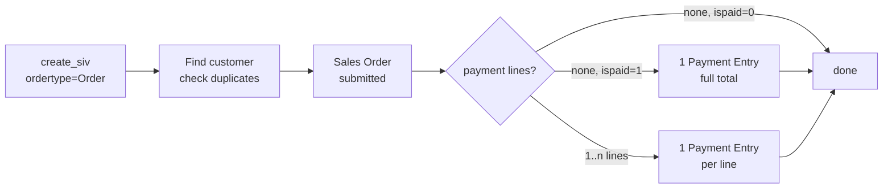
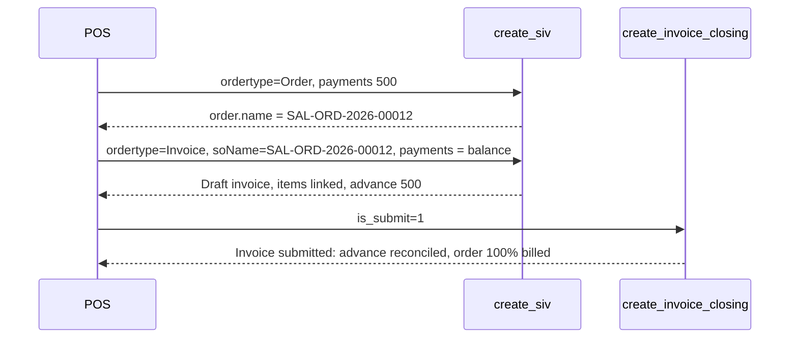
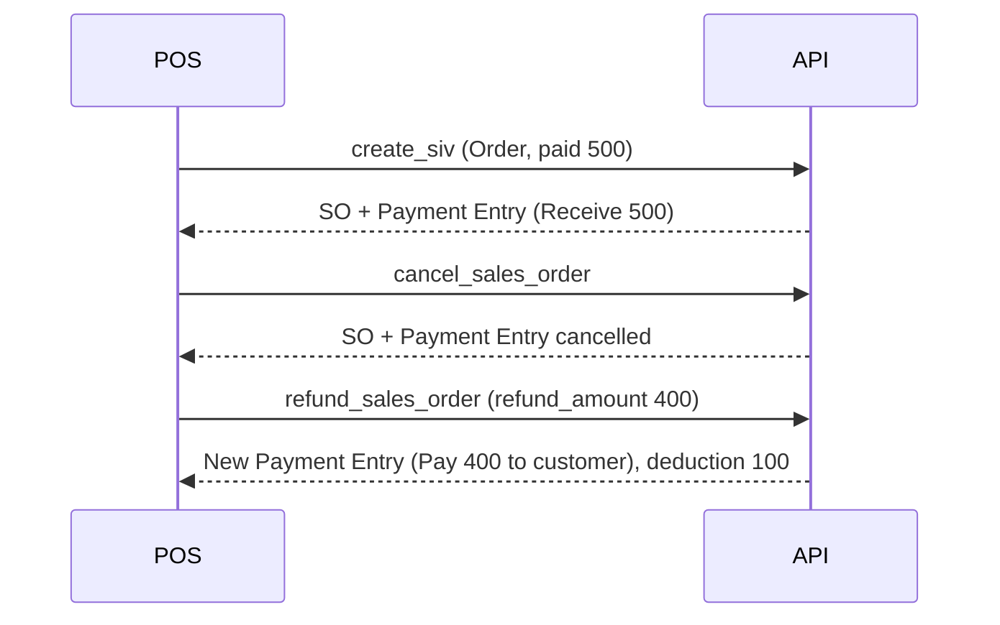
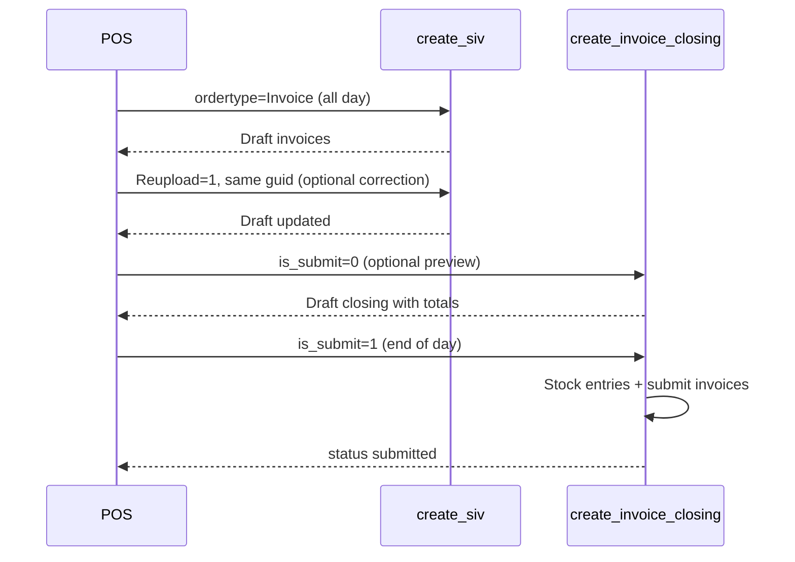

# Sales Sync API

Source: [`stringerp/v1/api.py`](../stringerp/v1/api.py) · Tests: [`stringerp/v1/test_api.py`](../stringerp/v1/test_api.py) · Ready-made requests: [`stringerp/v1/api-test.http`](../stringerp/v1/api-test.http)

This API connects the external POS to ERPNext. The POS sends invoices and orders, takes advance payments, cancels orders, pays refunds, and closes the day.

| # | Endpoint | What it does |
|---|---|---|
| 1 | [`create_siv`](#1-create_siv--sales-invoice-debit-note-sales-order) | Creates a Sales Invoice, Debit Note or Sales Order (with advance payments) |
| 2 | [`cancel_sales_order`](#2-cancel_sales_order) | Cancels a Sales Order and all of its payments |
| 3 | [`refund_sales_order`](#3-refund_sales_order) | Pays money back to the customer of a cancelled Sales Order |
| 4 | [`create_invoice_closing`](#4-create_invoice_closing) | Day-end closing for a POS profile: collects and submits the day's invoices |
| 5 | [`get_customer_details`](#5-get_customer_details) | Reads one customer |

---

## Basics

### URL and authentication

```
POST https://<your-site>/api/method/stringerp.v1.api.<endpoint>
Content-Type: application/json
Authorization: token <api_key>:<api_secret>
```

All endpoints require a logged-in API user (guest access is off). Send the body as JSON. A body wrapped in a `data` string (`{"data": "{...}"}`) is also accepted.

### Responses and status codes

Frappe wraps every response in a `message` key. Every response body has a `status` field.

```json
{ "message": { "status": "success", ... } }
{ "message": { "status": "error", "message": "Sales Order SAL-ORD-2026-00099 not found" } }
```

| HTTP | Meaning | Example |
|---|---|---|
| `200` | Success | Order created |
| `403` | The API user lacks permission | Cannot read this customer |
| `404` | The record was not found | Unknown `sales_order` / `guid` |
| `409` | Another request changed the same record at the same moment. **Retry.** | Two refunds for one order at once |
| `417` | The request breaks a business rule | Duplicate guid, overpayment, refund too large |

### Safety guarantees

- **All or nothing.** If any step fails, everything that request wrote is undone. Example: an order whose second payment fails leaves no order and no payment behind, so it can be retried with the same `guid`.
- **No duplicates.** A `guid` or `customerOrdernumber` that already exists is rejected, even if two identical requests arrive at the same time.
- **Every call is logged** in the **API Call Log** doctype. Failures also create an **Error Log** entry with the full traceback.

---

## 1. `create_siv` · Sales Invoice, Debit Note, Sales Order

One endpoint for all three documents. `ordertype` decides which one is created.

| `ordertype` | Creates | State after the call |
|---|---|---|
| `Invoice` | Sales Invoice (POS, updates stock) | **Draft.** It is submitted at day end by `create_invoice_closing`. |
| `Debit note` | Sales Invoice with `is_debit_note = 1` | Draft |
| `Order` | Sales Order, plus one Payment Entry per payment line | **Submitted**, payments submitted |

### Request body

This is the POS client format. All keys are shown; the ones marked *Order* or *Invoice* are only used for that type.

```json
{
  "ordertype": "Invoice",
  "guid": "69bfad62d5aw8d5",
  "customerOrdernumber": "BTS-242600162",
  "customercode": "Walkin Customer",
  "firstName": "Walkin Customer",
  "custname": "",
  "phoneNumber": "",
  "altPhone": "",
  "address1": "Flat: , Building: , Street: , Block: ",
  "salesmancode": "461",
  "deliverymancode": "",
  "onlineOrderId": "",
  "salestype": "DI",
  "posProfile": "TAWOOK-SEEF",
  "CRTime": "2026-03-22 11:50:42",
  "billDate": "2026-03-22 11:50:42",
  "tableno": "INDOOR T2-A",
  "noOfPax": "1",
  "Remarks": "",
  "Reupload": 0,
  "ispaid": 1,
  "subtotal": 2,
  "SubTotalDiscount": 0.2,
  "shipping": 0,
  "nettotal": 1.8,
  "VATAmount": 0.18,
  "nettotalwithVAT": 1.98,
  "posPayCode": 2,
  "items": [
    {
      "barcode": "258",
      "quantity": 1,
      "UnitPrice": 2,
      "rate": 2,
      "discrate": 0.2,
      "UnitDisc": 0.2,
      "DiscTID": "DINE IN"
    }
  ],
  "deliveryCharges": [],
  "payments": [
    { "POS_PAYCODE": 2, "CARDTYPE": "CASH", "CARDNO": "", "AMOUNT": 1.98 }
  ]
}
```

### Field reference

**Header**

| Key | Required | Used for | Maps to |
|---|---|---|---|
| `ordertype` | ✅ | Both | `Invoice`, `Debit note` or `Order` |
| `guid` | Recommended | Both | `custom_guid`. Unique per document; the duplicate check uses it. |
| `customerOrdernumber` | Recommended | Both | `custom_customer_order_no`. Unique per document. |
| `customercode` | ✅ Invoice; recommended for Order | Both | Customer found by `custom_customer_code`. It must exist. |
| `firstName` | Order without `customercode` | Order | Walk-in fallback: customer found by name, **created** if missing |
| `salesmancode` | Optional | Both | Sales Person found by `custom_sales_person_code`. It must exist. |
| `CRTime` | ✅ | Both | `posting_date` + `posting_time` (Invoice), `transaction_date` + `delivery_date` (Order; today if missing). Format `YYYY-MM-DD HH:MM:SS`. |
| `billDate` | Invoice | Invoice | `due_date` |
| `posProfile` | Invoice | Invoice | `pos_profile` |
| `ispaid` | Optional | Both | Invoice: reads `payments[]` into the invoice. Order: pays the full total when no payment lines are sent. |
| `soName` | Optional | Invoice | Name of the Sales Order this invoice bills (e.g. `SAL-ORD-2026-00012`). Links the invoice to the order and applies the order's advance payments. Leave it out for an independent invoice. See [Invoicing a Sales Order](#invoicing-a-sales-order-soname). |
| `Reupload` | Optional | Invoice | `1` replaces an existing **draft** invoice that has the same `guid` |
| `salestype` | Optional | Invoice | `custom_bill_type`: `DI` Dine In, `HD` Home Delivery, `TK` Take Away, `ON` Online, `OT` Others |
| `custname`, `phoneNumber`, `altPhone`, `address1` | Optional | Invoice (Order: `address1` only) | Walk-in customer fields |
| `deliverymancode`, `tableno`, `noOfPax`, `onlineOrderId`, `Remarks` | Optional | Invoice (Order: `Remarks` only) | Matching `custom_*` fields |
| `discountAmount`, `additionalDiscountGL` | Optional | Invoice | Additional discount on Net Total, and its account |
| `SubTotalDiscount` | Optional | Order | `discount_amount` |
| `subtotal`, `nettotal`, `VATAmount`, `nettotalwithVAT`, `shipping`, `posPayCode` | – | – | Informational only. ERPNext recalculates totals from the items and taxes. |

**`items[]` and `deliveryCharges[]`**: each row becomes one line.

| Key | Maps to |
|---|---|
| `barcode` | `item_code` (must be an existing Item) |
| `quantity` | `qty` (default 1) |
| `rate` | `price_list_rate` |
| `UnitDisc` ÷ `UnitPrice` × 100 | `discount_percentage` |
| `UnitDisc` | `custom_discount_rate` |
| `DiscTID` | `custom_discount_type` (must exist in **Discount Type**) |

**`payments[]`**

| Key | Invoice | Order |
|---|---|---|
| `CARDTYPE` | Mode of Payment on the invoice (default `Cash`) | Mode of Payment of the Payment Entry; money goes to that mode's default account |
| `AMOUNT` | Amount | Amount of that Payment Entry. The total may not exceed the order total. |
| `CARDNO` | Reference no. | Reference no. (default: the order name) |

### Sales Order payments

Each payment line becomes **its own Payment Entry** against the order.

| You send | Result |
|---|---|
| No payment lines, `ispaid: 0` | Order only, nothing paid |
| No payment lines, `ispaid: 1` | One Payment Entry for the **full** order total |
| One line equal to the total | Fully paid |
| One line **less** than the total (e.g. 500 of 1035) | **Partial advance**. `outstanding_amount` is the rest. |
| Several lines (e.g. 300 CASH + 200 VISA) | One Payment Entry per line, each into its own account |
| Lines adding up to more than the total | Rejected (417); nothing is created |



### Invoicing a Sales Order (`soName`)

To bill an order created earlier with `ordertype: Order`, send `ordertype: Invoice` with **`soName`** set to the order name returned in `order.name`. Without `soName`, the invoice is independent, the same as before.

The invoice is linked the same way as ERPNext's **Sales Order → Create → Sales Invoice**:

| What happens | Details |
|---|---|
| Items are linked to the order | Each invoice item is matched by `barcode` to an order line that still has unbilled qty, and gets `sales_order` + `so_detail`. Qty already on other non-cancelled invoices (drafts included) is not billed again. Items with no match stay unlinked. |
| Advances are applied | Payment Entries taken on the order (full or partial) are added to the invoice's **Advance Payments** table, up to the invoice total (VAT included). |
| `payments[]` is the balance only | Send only what the customer pays now: invoice total − advance. When the advance covers everything, send no payment lines; a 0-amount line with the POS Profile's default mode is added automatically. |
| On submit (Invoice Closing) | The advance Payment Entry is reconciled to the invoice (outstanding becomes 0) and the order's **% Billed** and status update. |
| Partial billing | An order can be billed by several invoices (e.g. qty 2 → two invoices of qty 1). |



Request (abbreviated):
```json
{
  "ordertype": "Invoice",
  "soName": "SAL-ORD-2026-00012",
  "guid": "INV-0002",
  "customerOrdernumber": "BTS-0002",
  "customercode": "Walkin Customer",
  "posProfile": "TAWOOK-SEEF",
  "CRTime": "2026-11-15 10:00:00",
  "billDate": "2026-11-15 10:00:00",
  "ispaid": 1,
  "items": [{ "barcode": "BT0023", "quantity": 1, "UnitPrice": 1000, "rate": 1000, "UnitDisc": 100, "DiscTID": "DINE IN" }],
  "deliveryCharges": [],
  "payments": [{ "CARDTYPE": "CASH", "CARDNO": "", "AMOUNT": 535 }]
}
```

Response `200` (main fields):
```json
{
  "message": {
    "status": "success",
    "invoice": {
      "name": "BTS-0002",
      "docstatus": 0,
      "grand_total": 1035.0,
      "total_advance": 500.0,
      "outstanding_amount": 0.0,
      "items": [{ "item_code": "BT0023", "qty": 1.0, "sales_order": "SAL-ORD-2026-00012", "so_detail": "a1b2c3d4e5" }],
      "payments": [{ "mode_of_payment": "CASH", "amount": 535.0 }]
    }
  }
}
```

The customer on the invoice (`customercode`) must be the order's customer.

### Examples

**Sales Invoice, paid in cash**

Request (abbreviated; send the full body above):
```json
{
  "ordertype": "Invoice",
  "guid": "INV-0001",
  "customerOrdernumber": "BTS-0001",
  "customercode": "Walkin Customer",
  "salesmancode": "461",
  "posProfile": "TAWOOK-SEEF",
  "CRTime": "2026-11-14 10:00:00",
  "billDate": "2026-11-14 10:00:00",
  "ispaid": 1,
  "items": [{ "barcode": "BT0023", "quantity": 1, "UnitPrice": 1000, "rate": 1000, "UnitDisc": 100, "DiscTID": "DINE IN" }],
  "deliveryCharges": [],
  "payments": [{ "CARDTYPE": "CASH", "CARDNO": "", "AMOUNT": 1035 }]
}
```

Response `200`:
```json
{
  "message": {
    "status": "success",
    "invoice": {
      "name": "BTS-0001",
      "docstatus": 0,
      "customer": "Walkin Customer",
      "posting_date": "2026-11-14",
      "pos_profile": "TAWOOK-SEEF",
      "custom_guid": "INV-0001",
      "net_total": 900.0,
      "total_taxes_and_charges": 135.0,
      "grand_total": 1035.0,
      "items": [{ "item_code": "BT0023", "qty": 1.0, "price_list_rate": 1000.0, "discount_percentage": 10.0, "rate": 900.0 }],
      "payments": [{ "mode_of_payment": "CASH", "amount": 1035.0 }],
      "taxes": [{ "account_head": "VAT 15%", "tax_amount": 135.0 }]
    }
  }
}
```
`invoice` holds every Sales Invoice field and its child tables. Only the main ones are shown here.

**Sales Order with a partial advance of 500**

Request:
```json
{
  "ordertype": "Order",
  "guid": "SO-0001",
  "customerOrdernumber": "BTS-SO-0001",
  "customercode": "Walkin Customer",
  "salesmancode": "461",
  "CRTime": "2026-11-14 10:00:00",
  "ispaid": 0,
  "items": [{ "barcode": "BT0023", "quantity": 1, "UnitPrice": 1000, "rate": 1000, "UnitDisc": 100, "DiscTID": "DINE IN" }],
  "deliveryCharges": [],
  "payments": [{ "CARDTYPE": "CASH", "CARDNO": "", "AMOUNT": 500 }]
}
```

Response `200`:
```json
{
  "message": {
    "status": "success",
    "order": { "name": "SAL-ORD-2026-00012", "docstatus": 1, "customer": "Walkin Customer", "grand_total": 1035.0, "status": "To Deliver and Bill" },
    "payment": { "name": "ACC-PAY-2026-00031", "payment_type": "Receive", "mode_of_payment": "CASH", "paid_amount": 500.0, "paid_to": "Cash - MH", "docstatus": 1 },
    "paid_amount": 500.0,
    "outstanding_amount": 535.0
  }
}
```

**Sales Order, split payment (300 CASH + 200 VISA):** `payment` becomes a **list**, with one entry per line.
```json
{
  "message": {
    "status": "success",
    "order": { "name": "SAL-ORD-2026-00013", "grand_total": 1035.0 },
    "payment": [
      { "name": "ACC-PAY-2026-00032", "mode_of_payment": "CASH", "paid_amount": 300.0 },
      { "name": "ACC-PAY-2026-00033", "mode_of_payment": "VISA", "paid_amount": 200.0 }
    ],
    "paid_amount": 500.0,
    "outstanding_amount": 535.0
  }
}
```
`payment` is `[]` when nothing is paid, a single object for one payment, and a list for two or more.

**Errors**

| HTTP | `message` |
|---|---|
| 417 | `Invalid ordertype` |
| 417 | `Customer code is missing` / `Customer with customer code X is missing` |
| 417 | `Sales Person 461 is missing` |
| 417 | `Invoice already exists with GUID: ...` / `Order already exists with GUID: ...` |
| 417 | `Order already exists with Customer Order No: ...` |
| 417 | `Reupload: No draft invoice found with GUID: ...` |
| 417 | `Payment amount 99999.0 exceeds Sales Order total 1035.0` |
| 404 | `Sales Order X not found` (`soName` unknown) |
| 417 | `Sales Order X is not submitted` (draft or cancelled order in `soName`) |
| 417 | `Sales Order X belongs to customer A, not B` |
| 417 | `Sales Order X is already fully billed or closed` |
| 417 | `No invoice item matches an unbilled item of Sales Order X` |
| 417 | `POS Profile X has no mode of payment` (order fully prepaid, no payment lines, profile has no modes) |
| 409 | `Another request changed the same records at the same time. Please retry.` |

---

## 2. `cancel_sales_order`

Cancels a submitted Sales Order and **every** Payment Entry received against it, in one step.

### Request

Send **one** of these keys to identify the order:

| Key | Example |
|---|---|
| `sales_order` | `"SAL-ORD-2026-00012"` |
| `guid` | `"SO-0001"` |
| `customerOrdernumber` | `"BTS-SO-0001"` |

```json
{ "customerOrdernumber": "BTS-SO-0001" }
```

### Response `200`

```json
{
  "message": {
    "status": "success",
    "message": "Sales Order SAL-ORD-2026-00012 cancelled",
    "sales_order": "SAL-ORD-2026-00012",
    "cancelled_payments": [
      { "name": "ACC-PAY-2026-00031", "paid_amount": 500.0, "mode_of_payment": "CASH" }
    ]
  }
}
```

### When it refuses

Nothing is cancelled when any of these apply:

| HTTP | `message` | What to do |
|---|---|---|
| 404 | `Sales Order X not found` / `No Sales Order found with guid: X` | Check the identifier |
| 417 | `Send one of: sales_order, guid, customerOrdernumber` | Add an identifier |
| 417 | `Sales Order X is already cancelled` | Nothing; it is already done |
| 417 | `Sales Order X is a draft and cannot be cancelled` | – |
| 417 | `Cannot cancel Sales Order X; cancel these first: Sales Invoice ..., Delivery Note ...` | The order has already been billed (an invoice sent with its `soName` was submitted) or delivered. Cancel or return those first. |
| 417 | `Payment Entry X is also allocated to ...; cancel it manually` | That payment also covers other documents; an accountant must handle it |

---

## 3. `refund_sales_order`

Pays money back to the customer of a **cancelled** Sales Order. Use it when the refund is less than what was paid, for example a cancellation fee is kept.



### Request

| Key | Required | Description |
|---|---|---|
| `sales_order` / `guid` / `customerOrdernumber` | ✅ (one of) | The cancelled order |
| `refund_amount` | ✅ | Amount paid back. Must be more than 0 and no more than what is still refundable. |
| `mode_of_payment` | Optional | Pays out from this mode's default account. Default: the company's cash account. |
| `reference_no` | Optional | Cheque, card or transaction number. Default: the order name. |

```json
{
  "customerOrdernumber": "BTS-SO-0001",
  "refund_amount": 400,
  "mode_of_payment": "CASH",
  "reference_no": ""
}
```

**Refundable amount** = what the customer paid on the order (its cancelled payments) − refunds already made against it. Several partial refunds are allowed up to that limit.

### Response `200`

```json
{
  "message": {
    "status": "success",
    "message": "Refund of 400.0 paid to Walkin Customer",
    "sales_order": "SAL-ORD-2026-00012",
    "customer": "Walkin Customer",
    "payment_entry": "ACC-PAY-2026-00034",
    "refund_amount": 400.0,
    "paid_on_order": 500.0,
    "deduction": 100.0
  }
}
```

| Field | Meaning |
|---|---|
| `payment_entry` | The new submitted Payment Entry (type **Pay**, party = the customer) |
| `paid_on_order` | What the customer originally paid on the order |
| `deduction` | What is left after this refund (e.g. kept as a cancellation fee) |

The refund Payment Entry stores the order in **Refund Against Sales Order** (`custom_refund_against_sales_order`).

### When it refuses

| HTTP | `message` |
|---|---|
| 404 | `Sales Order X not found` / `No Sales Order found with ...` |
| 417 | `Sales Order X is not cancelled; cancel it before refunding` |
| 417 | `refund_amount must be greater than 0` |
| 417 | `No cancelled payment found for Sales Order X; nothing to refund` |
| 417 | `Refund 200.0 exceeds refundable amount 100.0 (paid 500.0, already refunded 400.0)` |
| 409 | `Another request changed the same records at the same time. Please retry.` |

> **Accounting note.** The original receipt is cancelled, so after a refund ERPNext shows the customer as **owing** the refunded amount, and the amount kept is not booked as income. Agree with your accountant on a journal entry or adjustment for this.

---

## 4. `create_invoice_closing`

Day-end closing for one POS profile. It collects that day's draft invoices and, when `is_submit = 1`, creates and submits the stock entries and submits the invoices.

### Request

| Key | Required | Description |
|---|---|---|
| `pos_profile` | ✅ | POS Profile name |
| `invoice_date` | ✅ | `YYYY-MM-DD` |
| `is_submit` | Optional | `0` (default): create a draft closing. `1`: also submit it, which creates stock entries and submits the invoices. |

```json
{ "pos_profile": "TAWOOK-SEEF", "invoice_date": "2026-11-14", "is_submit": 0 }
```

### Responses

The `status` value tells you what happened:

| `status` | When |
|---|---|
| `success` | A new closing was created (and submitted, if `is_submit = 1`) |
| `exists` | A closing for this profile and date already exists; it is returned unchanged |
| `submitted` | An existing **draft** closing was submitted (`is_submit = 1`) |

```json
{
  "message": {
    "status": "success",
    "invoice_closing": {
      "name": "INV-CLOS-11-14-00153",
      "docstatus": 0,
      "status": "Draft",
      "pos_profile": "TAWOOK-SEEF",
      "warehouse": "Stores - MH",
      "invoice_date": "2026-11-14",
      "total_amount": 4255.0,
      "invoice_count": 5,
      "bom_count": 0,
      "raw_material_count": 0
    }
  }
}
```

```json
{
  "message": {
    "status": "exists",
    "message": "Invoice Closing already exists for this POS Profile and date",
    "invoice_closing": { "name": "INV-CLOS-11-14-00153", "docstatus": 0, "status": "Draft", "invoice_count": 5 }
  }
}
```

Typical day:



**Errors:** `417 pos_profile is required`, plus any validation error raised while submitting (stock, ZATCA, etc.). Nothing is kept when submitting fails.

---

## 5. `get_customer_details`

```
GET /api/method/stringerp.v1.api.get_customer_details?customer_id=Walkin%20Customer
```

Response `200`:
```json
{
  "message": {
    "status": "success",
    "message": "Customer fetched successfully",
    "data": {
      "name": "Walkin Customer",
      "customer_name": "Walkin Customer",
      "customer_group": "Individual",
      "territory": "All Territories",
      "mobile_no": null,
      "email_id": null
    }
  }
}
```

| HTTP | `message` |
|---|---|
| 400 | `Missing required parameter: customer_id` |
| 404 | `Customer not found` |
| 403 | `You do not have permission to access this resource.` |

---

## Master data the site needs

The API looks these up and rejects the request if they are missing:

| What | Where | Used by |
|---|---|---|
| Customer with **Customer Code** (`custom_customer_code`) | Customer | `customercode` |
| Sales Person with **Sales Person Code** (`custom_sales_person_code`) | Sales Person | `salesmancode` |
| Item for each `barcode` | Item | `items[]`, `deliveryCharges[]` |
| Mode of Payment for each `CARDTYPE`, with a default account for the company | Mode of Payment | `payments[]`, refunds |
| Every `DiscTID` value (e.g. `DINE IN`, `ENTERTAINER`) | Discount Type | `items[].DiscTID` |
| POS Profile with its payment modes | POS Profile | `posProfile`, Invoice Closing |

The app's custom fields (guid, customer order no, walk-in fields, refund link, …) come from `fixtures/custom_field.json` and are installed by `bench migrate`.

---

## Running the tests

```bash
bench --site <site> set-config allow_tests true
bench --site <site> set-config --parse stringerp_test '{
  "customer": "<customer name>", "customer_code": "<its customer code>",
  "item": "<item code with stock>", "mode_of_payment": "<mode>",
  "mode_of_payment_2": "<second mode>", "company": "<company>",
  "pos_profile": "<POS profile of that company>"
}'
bench --site <site> run-tests --module stringerp.v1.test_api
```

The order-flow and invoice-flow tests skip themselves when `stringerp_test` is not set. Each test is rolled back, so no data is left behind.

---

## Known limitations

1. **`Reupload` and `ispaid` are read as true for any non-empty value.** Send `0` or leave them out for "no"; the strings `"0"` and `"false"` count as true.
2. **Debit notes** have no `return_against` and no duplicate check of their own.
3. **Invoice line discounts:** `discount_percentage` is calculated from `UnitPrice` but applied to `rate`. When the two differ, the discount is applied to a different price than the one it was worked out from.
4. **Refund accounting** (see the note under `refund_sales_order`).
5. **Invoice from an order keeps the POS rates and taxes.** They are taken from the invoice payload, not copied from the order. If "Maintain Same Rate Throughout Sales Cycle" is on in Selling Settings, a different rate is rejected.
6. **POS advances are reconciled by this app.** ERPNext itself only reconciles advances on non-POS invoices; the app's Sales Invoice `on_submit` hook (`stringerp.doc_events.sales_invoice.on_submit`) does it for POS invoices.
